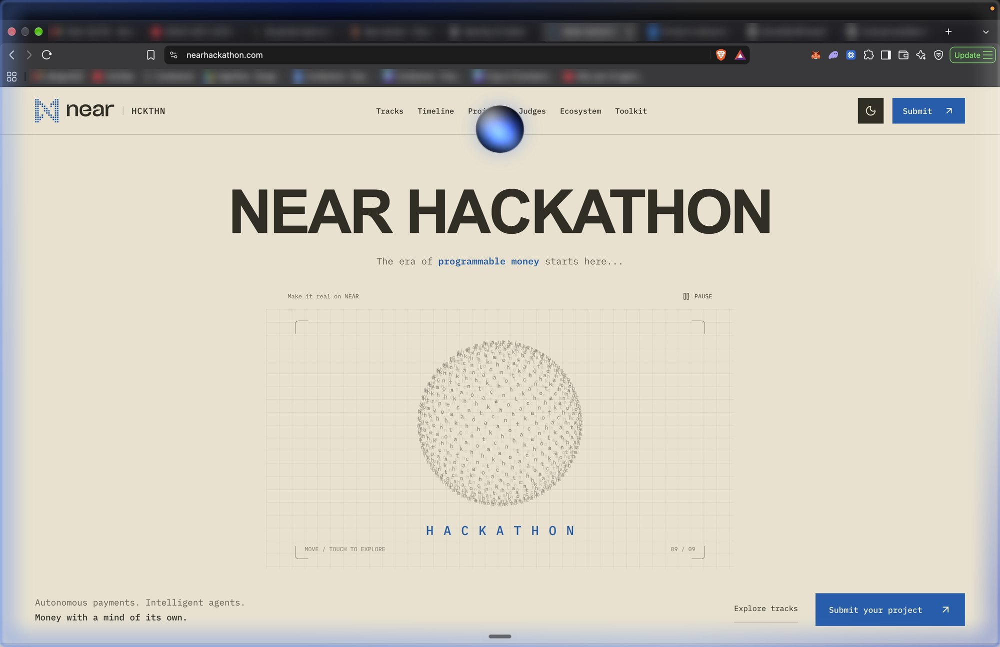
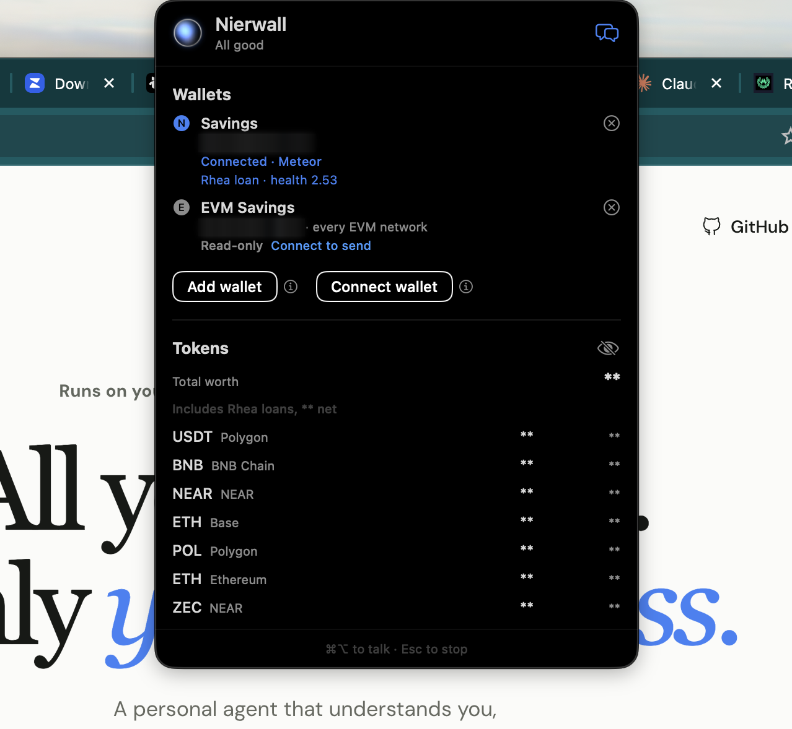
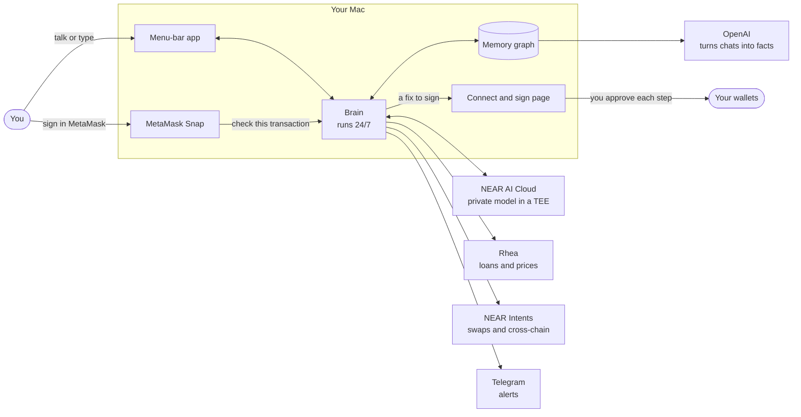

<p align="center"></p>

# Nierwall

**A private DeFi assistant in your Mac's menu bar.** It watches your wallets and Rhea loans around the clock,
warns you before a loan gets liquidated, prepares a fix you sign in your own wallet, and checks MetaMask
transactions before you approve them. Hold **⌘⌥** anywhere and talk to it like Siri.

Built at NEAR HACKATHON · Tracks: Privacy & Private AI · AI Security & Defense · Open Innovation

> Prices drop → Nierwall notices → your Mac and phone ping → you pick a fix → you sign it in your wallet →
> Nierwall confirms it worked. It never holds a key and never signs anything. That part is always you.

```bash
pnpm install && cp .env.example .env    # every key in .env is optional
pnpm sign:build                         # the connect-and-sign page
pnpm brain                              # terminal 1: the always-on brain
pnpm mac                                # build and open the menu-bar app
```

## Why

To get advice on your portfolio today, you have to share all of it. A portfolio app, an AI chatbot or a human
advisor needs every wallet address and every position before it can tell you anything useful. A crypto address is
more than a balance: whoever has it can see your whole on-chain history, permanently.

So people pick one: get advice and give up their privacy, or keep their privacy and look after their loans alone.

**Not with Nierwall.** It gives you the advice without taking your data. It reads your wallets from your own Mac.
Its AI runs privately in a TEE (a sealed, verified chip) on NEAR AI Cloud, and Nierwall checks that before the first
question. Chats are encrypted end to end, and the AI knows your wallets only by their nicknames, never their
addresses. Your keys never leave your wallet.

## Take a peek

### The orb

Hold ⌘⌥ in any app and it drops in at the top of your screen, over whatever you were doing (here, the NEAR HACKATHON
site), while a soft blue glow lights up the screen edges. Talk, pause, and it answers out loud, then listens for your
follow-up. Press Esc, or just go quiet, and it slips away.

<p align="center"></p>

### The shield

Click it in the menu bar for your wallets (connected or read-only), every token on every chain with your total
worth, and your Rhea loans with their health. Tap the eye and every number becomes `**`, handy on a screen share.
(Addresses blurred for this screenshot.)

<p align="center"></p>

## Get it running

**You'll need:** macOS 14+ (voice needs macOS 26), Node 24+, pnpm 10 and the Xcode Command Line Tools. Memory also
wants Python 3.14 from Homebrew.

Run the four commands at the top and the shield appears in your menu bar. Want more?

```bash
pnpm memory:setup && pnpm memory   # memory service, in a second terminal
pnpm always-on                     # start everything at login, restart anything that crashes
```

Every key is optional. Nierwall still runs without them, just with fewer tricks:

| Key in `.env` | Unlocks | Without it |
|---------------|---------|------------|
| `NEAR_AI_API_KEY` | Real conversation, plans and alert judgment on NEAR AI Cloud | Short built-in answers from computed numbers |
| `OPENAI_API_KEY` | Memory of your goals and limits | A goldfish: nothing is remembered |
| `TELEGRAM_BOT_TOKEN` | Alerts on your phone (bot from @BotFather) | Alerts on the Mac only |
| `COINGECKO_API_KEY` | A higher limit for finding coins by name | The public limit; prices come from DefiLlama, no key |

Nierwall starts with an empty shield. **Add wallet** watches one by its address (you.near, 0x…, or a Solana
address), read-only. **Connect wallet** opens a page in your browser for Meteor or another NEAR wallet, or MetaMask
for EVM networks. Nierwall gets the address and nothing else, and from then on can send that wallet fixes for you to
approve.

## Things to try

| Do this | And see |
|---------|---------|
| Add a NEAR wallet that has a Rhea loan | The shield fills in: tokens, total worth, and the loan's health with everything supplied and borrowed, token by token with APR. It refreshes itself every minute. |
| Hold ⌘⌥ and ask "How's my Rhea loan?" | The orb answers out loud and waits for your next question |
| Ask "How safe is my Rhea loan?" | A floor and repair target the AI picked from 90 days of price swings, with its reason, for you to confirm |
| Say "Tell me if SOL drops below $70" | A price watch, ready to confirm |
| Say "Keep at least 20% in stablecoins" | A portfolio-mix rule that plans and the Snap respect from then on |
| Fake a crash: `pnpm simulate NEAR -9` (undo: `pnpm simulate off`) | An alert labeled SIMULATED on your Mac (and in Telegram, if linked), with fixes |
| Ask "How do I make my Rhea loan safer?", then say "yes" | Meteor (or MetaMask) opens with the first step to approve, and the orb tells you when it's done |
| Ask "Rebalance me toward 30% stablecoins" | Plan cards: loan health and mix before and after, the cost, and **Review & sign** |
| Ask the orb to turn on transaction safety, run `pnpm snap`, open `http://127.0.0.1:7420/snap/install` in MetaMask Flask | Nierwall's panel on MetaMask's confirmation screen, for every transaction |
| Click **Link** next to Telegram in the shield, then tap Start in Telegram | "Linked", and alerts start arriving on your phone |

Here's what lands when NEAR drops 9% (simulated, of course):

> **Rhea · NEAR is below your floor.** Health factor 1.30 (your floor 1.33).
> **A.** Repay 4 USDC on Rhea from Savings → health 1.62.
> **B.** Add 3 NEAR as collateral from Savings → health 1.62.

## What's inside

**A watchful eye.** Rhea loan health and distance to liquidation (every minute, every 20 seconds near a limit), any
token's price, your portfolio mix, a minimum balance, and its own data sources too, so it tells you when it can't
see instead of going quiet.

**Alerts with judgment.** The AI rates how urgent things are from the market (12% from liquidation is scarier when
the collateral swings 7% a day) and says why. Some rules are set in code and never bend: health under 1.1, or under
5% from liquidation, is always critical, and alerts still go out if the AI is down. It nudges you if you don't
react, escalates if things get worse, and closes the issue when the loan recovers.

**Fixes you sign.** Repay or add collateral, sized with Rhea's own risk weights. Cash on the wrong chain? The fix
moves it with NEAR Intents first. Only connected wallets can send, and when more than one could, the orb asks which.

**Plans with a fact-checker.** The AI proposes up to two plans (swaps, moves between your wallets, Rhea repays) but
never does the math. Your Mac replays every step against real balances and live quotes, and throws out anything
that overspends, pushes a loan toward liquidation, breaks a reserve, or costs more than it's worth. Money only ever
moves between your own wallets, Rhea and NEAR Intents.

**A second look before you sign.** The Nierwall Snap runs each MetaMask transaction on its network's latest block
before you approve it: what you send and get, rules it would break (with a better idea), bad swaps, hidden unlimited
approvals, transfers to addresses that aren't yours, and NEAR transactions signed from MetaMask, with Rhea health
before and after. It never blocks you, and it says "not checked" rather than pretend.

**A voice that stays home.** Speech is recognized on your Mac and the audio never leaves it. ⌘⌥ is detected without
keyboard permissions, so Nierwall never sees what you type.

## NEAR, and a few friends

- **NEAR AI Cloud** is the brain's brain. Chat and alert judgment run on `z-ai/glm-5.3-flash` and plans on
  `deepseek-ai/DeepSeek-V4.1-Flash-1017`, both inside TEEs. Nierwall checks each model's attestation before the first
  question, encrypts the chat end to end, and verifies every reply's signature.
- **NEAR Intents** moves the money. Every swap and cross-chain hop goes through its 1Click API, like USDC from
  Arbitrum to NEAR to repay a loan. Before you see a quote, Nierwall checks it pays your own account, matches the
  route and amount, stays within slippage and leaves time to send. Its token list also decides which tokens get read
  and priced in your wallets.
- **Rhea** is where the loans live. Nierwall reads every position straight from Rhea's lending contract and
  previews each fix with Rhea's own risk weights.
- **NEAR Connect** brings the wallets: Meteor, HOT, Intear, MyNearWallet and more, for connecting and signing.
- **And the friends:** MetaMask signs on EVM networks and hosts the Snap, Telegram carries alerts to your phone,
  OpenAI turns chats into memory facts through Graphiti (nicknames only, never addresses), and DefiLlama and
  CoinGecko supply prices.

| Chains | |
|---|---|
| Wallets read | NEAR; Ethereum, Base, Arbitrum, OP Mainnet, Polygon, BNB Chain, Gnosis, Avalanche, Berachain, Scroll; Solana (read only) |
| Loans | Rhea on NEAR |
| Money moves | Between all of the above through NEAR Intents; Solana wallets only receive |
| Snap checks | 17 EVM networks and NEAR |

## How it works



| Path | Part | Built with |
|------|------|------------|
| `apps/brain` | Reads wallets and loans, runs watches, plans fixes, talks to the AI and Telegram, checks Snap transactions | TypeScript, Node 24 |
| `apps/mac` | Menu-bar shield, voice orb, chat, notifications | Swift, SwiftUI, Apple SpeechAnalyzer |
| `apps/sign` | Local page that connects wallets and hands each step of a fix to them | NEAR Connect, MetaMask (EIP-6963) |
| `apps/snap` | Pre-sign checks inside MetaMask | MetaMask Snaps SDK |
| `services/memory` | Your goals and limits as dated facts | Graphiti on embedded FalkorDB, FastAPI |
| `apps/landing` | Landing page | Static HTML |

Internal names still use the working name `guardian` (packages, env vars, `Sources/Guardian`).

## Your business stays your business

- **No keys, ever.** Nierwall never asks for, stores or uses a seed phrase or private key. Your wallet signs.
- **Private AI.** The model runs in a TEE on NEAR AI Cloud, verified before use.
- **The AI shows its work.** Every number in an AI answer must match what Nierwall computed, or you get the computed
  answer instead. Health math, the 1.05 hard stop for plans and the own-wallets rule live in code the AI can't touch.
- **Addresses stay out of memory.** They become "[address]" before any text reaches the memory service.
- **Simulations wear a label.** Anything simulated says SIMULATED everywhere and never enters memory.

<details>
<summary>What leaves your Mac, exactly</summary>

| Where | What |
|-------|------|
| NEAR AI Cloud (TEE) | Your messages and the position data used to answer them, with wallet nicknames, not addresses |
| OpenAI | Text for memory, with nicknames, never addresses |
| Telegram | Alert text, at the detail level in `TELEGRAM_DETAIL` |
| Public nodes (publicnode.com, drpc.org, mainnet.base.org, Solana mainnet-beta, FastNEAR) | Wallet addresses, to read balances and loans; transactions the Snap simulates. `RPC_URL_<chain id>` and `SOLANA_RPC_URL` use your own node first |
| DefiLlama, CoinGecko | Coin ids and token contracts for prices; never wallet addresses |
| NEAR Intents | Price checks use stand-in addresses; real ones only when you open a fix to sign |

Your wallet list, memory graph, history and voice audio stay on the Mac.

</details>

## Honest limits

- It naps when your Mac does: checks pause while the Mac sleeps or is offline, because the brain runs on it.
- Withdrawing Rhea collateral opens the Rhea app instead of building the transaction.
- Bitcoin, and EVM networks NEAR Intents added recently (such as Monad), aren't read yet.
- A local Snap needs MetaMask Flask.
- Try your first fix with a small amount.

## Tests

`pnpm test` runs 74 brain tests, 3 of them against mainnet (`OFFLINE=1 pnpm test` skips those).
`apps/mac/scripts/check.sh` checks the voice turn-taking. The day-by-day log is in [docs/PROGRESS.md](docs/PROGRESS.md).

## Libraries and AI disclosure

Built during the hackathon, starting 12 Nov 2026, with no code from before it. Most of the code was written by
Claude Code under the team's direction. Main libraries: `@rhea-finance/cross-chain-sdk`, `@nearai/inference-sdk`,
`@hot-labs/near-connect`, `viem`, `hono`, `zod`, `@metamask/snaps-sdk`, `graphiti-core`, `falkordblite`, `fastapi`.

## License

MIT. See [LICENSE](LICENSE).
