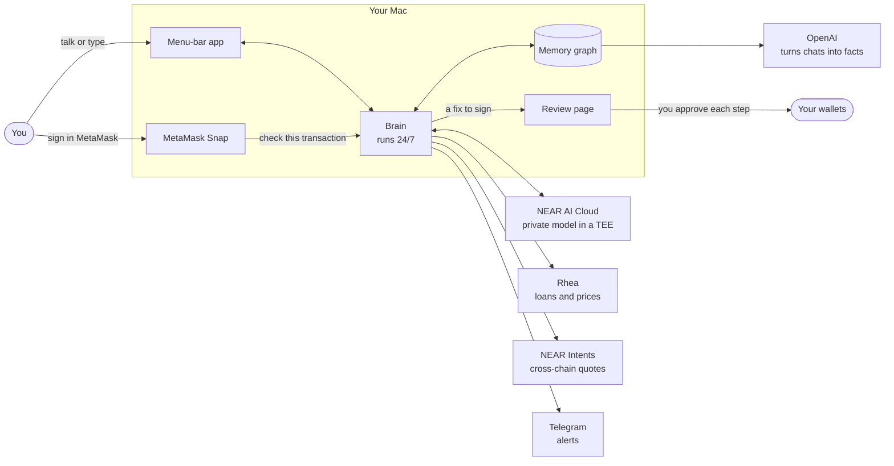

# Nierwall

**A private DeFi assistant that lives in your Mac's menu bar.** Nierwall watches your crypto loans around the
clock, warns you before they get liquidated, prepares a fix you sign in your own wallet, and checks transactions
inside MetaMask before you approve them. You can talk to it like Siri.

Built for the NEAR HACKATHON. Tracks: Privacy & Private AI · AI Security & Defense · Open Innovation.

**In one line:** prices drop → Nierwall notices → alert on your Mac and phone → you pick a fix → you sign it in
your wallet → Nierwall confirms it worked.

---

## Why

Many people borrow against their crypto: deposit NEAR or ETH, borrow stablecoins against it. If prices fall far
enough, the lending protocol liquidates the loan. It sells part of your collateral at a discount, and you take
the loss. This often happens overnight, faster than anyone checks a dashboard.

The other common way to lose money is the moment of signing: an unlimited token approval, a withdrawal that
leaves a loan exposed, a deposit to the wrong address.

Most tools today either send a bare price alert or ask you to hand a bot your keys. Nierwall does neither. It
knows your positions and the limits you set, explains what's happening in plain words, prepares the fix, and
leaves the signing to you.

## What it does

### 1. You talk to it

Nierwall starts with no wallets. There are two ways to add one, from the shield in the menu bar, or by asking the orb
(press **⌘⌥** and say "help me set up"):

- **Add wallet** to watch it: type its address (a NEAR account like you.near, a 0x address, or a Solana address) and a name.
  Nierwall reads its balances and any Rhea loan and alerts you, but never sends it anything.
- **Connect wallet**: a page opens in your browser where you pick Meteor or another NEAR wallet, or MetaMask for EVM
  networks. Nierwall gets only the address (no keys, no signature), and can now send that wallet fixes and swaps
  for you to approve. Connecting an address you already watch upgrades it.

Any Rhea loan shows up right away, and alerts start once you confirm a floor the orb proposes. The shield opens on
your wallets, each marked connected or read-only, with the features you can turn on and a demo portfolio to look
around first (see [Demo portfolio](#demo-portfolio)); the chat is behind the button at the top right.

Press **⌘⌥** in any app and a Siri-style orb appears a fifth of the way down your screen, over whatever you're doing:
blue light in a black glass sphere with a thin silver rim, and a soft glow around the edges. Just talk. When you pause, Nierwall answers out loud and then listens again, so you can
keep going like a conversation. Talk over it to cut in. Press **Esc** when you're done, or simply stop talking and
it goes away after a few quiet seconds. For example:

- "How's my Rhea loan?"
- "What happens if NEAR drops 20%?"
- "Ping me if my Rhea health goes under 1.5."

The orb follows your voice, swirls while Nierwall thinks, and pulses while it talks. When an answer has something
to act on, such as a fix with a **Review & sign** button or a new watch to confirm, the Nierwall panel opens under
the menu bar with the details while you keep talking. Nierwall starts a new watch only after you confirm it. The full chat history, with
health gauges and alerts, is always one click away on the shield in the menu bar.

When an answer is something to sign, such as repaying your Rhea loan, and the wallets it goes through are connected,
the orb says what it does and asks "Should I send it to Meteor?" (or MetaMask, or whichever wallet that is). Say yes
and that wallet opens with the first step; you approve each step there, and the orb tells you when it's done. Your
keys never leave your wallet, and it runs no code from Nierwall: Nierwall checks the transaction first, and the
wallet signs and sends it. Only a clear yes counts. "Yes, but first…" or a new question sends nothing.

Speech recognition runs on the Mac, and the audio never leaves it. The orb's voice goes through Apple's echo
cancellation, so the mic hears you and not the orb. ⌘⌥ is detected without keyboard permissions, so Nierwall
never sees what you type, and pressing another key with ⌘⌥ (a shortcut like ⌘⌥Esc) doesn't trigger it. Esc
belongs to the orb only while it's open.

### 2. It keeps watch and brings you a fix

A background service (the "brain") checks your loans on **Rhea**, NEAR's lending protocol, every minute, and
every 20 seconds when you're close to a limit. It sees every token in your wallets on NEAR and ten EVM networks (see
[Chains and NEAR Intents](#chains-and-near-intents)). It can watch:

- loan health, and how far prices can fall before liquidation
- the price of any token ("tell me if SOL drops below $70"), from DefiLlama's free price feed
- your portfolio mix ("keep at least 20% in stablecoins")
- a minimum balance you want to keep in a wallet
- its own data sources, so it tells you when it can't see instead of going quiet

You don't have to pick the numbers yourself. Ask how safe a loan is and the AI looks at how much its collateral
has moved over the last 90 days, then proposes a floor and a repair target with a one-line reason. Nothing
starts until you confirm.

When a limit is crossed you get a Mac notification and a Telegram message with fix options. The AI judges how
urgent it is from the market (a loan 12% from liquidation is more urgent when its collateral swings 7% a day), and
says why. Two rules stay fixed in code: health under 1.1, or less than 5% from liquidation, is always critical, and
if the AI is unavailable alerts still go out on fixed rules. If you don't react it reminds you, if things get worse
it escalates, and when the loan recovers it tells you and closes the issue.

Here is an alert from `pnpm demo --portfolio` (shortened), on the demo portfolio during a simulated 9% NEAR drop:

> **Rhea · NEAR is below your floor.** Health factor 1.30 (your floor 1.33).
> **A.** Repay 4 USDC on Rhea from Demo NEAR wallet → health 1.62.
> **B.** Add 3 NEAR as collateral from Demo NEAR wallet → health 1.62.

When the USDC sits on another network instead, the fix first moves it to NEAR with **NEAR Intents**. Before you see
it, Nierwall gets a live quote and checks it: the money goes to your own account, the route and amount match, the
minimum you receive is within slippage, and there's enough time to send. A review page then hands each step to the
wallet app that wallet was connected with: MetaMask for EVM networks (it switches MetaMask to the right one, and
adds it if MetaMask doesn't have it yet), and Meteor or another NEAR wallet for NEAR. Say yes to the orb and the
page goes straight to that wallet and asks for each step as it's ready. Nierwall follows the transfer and the
repayment until both are confirmed. Only connected wallets can send: a fix that would go through a wallet you only
watch shows **Connect to send** instead, and when more than one connected wallet could do what you ask, the orb asks
which one.

### 3. It advises, and checks every plan

Ask "how do I make my loans safer?" or "rebalance me toward 30% stablecoins". The AI looks at every token in every
wallet and your loans, then proposes up to two plans: swaps, moves between your own wallets (across chains too),
repaying or adding collateral on Rhea. It also decides how much each plan is worth paying in fees.

The AI never does the math. Your Mac replays each step against your real balances, your loans and live NEAR
Intents quotes, and rejects anything that doesn't add up: spending more than you hold, a loan pushed near
liquidation, a reserve you set, a cost above what the plan is worth. A plan can only move money between your own
wallets, Rhea and NEAR Intents; there's no way to name an outside address. What passes shows up as a card:
loan health before and after, your mix before and after, the cost, and **Review & sign**.

### 4. It checks transactions before you sign

The **Nierwall Snap** adds a panel to MetaMask's confirmation screen for every transaction MetaMask sends, on any
network. Before you sign, your Mac runs the exact transaction on that network's latest block without sending it, so
it works for any app or swap. That covers Ethereum, Base, Arbitrum, Optimism, Polygon, BNB Chain, Gnosis, Celo,
Linea, Berachain, Sonic, Unichain and Mantle. On networks whose nodes can't simulate (Avalanche, Scroll, zkSync,
Aurora) or that Nierwall doesn't know yet, it still reads transfers and approvals and says it only decoded the call.

- **What you send and get:** "You send 1,500 USDC ($1,500) · You get 0.74 ETH ($1,480)".
- **Your rules:** if a swap breaks a target mix you set, it says so and suggests what else you could use. For
  example: "Stablecoins would go from 30% to 15% of your portfolio. You set a minimum of 20%. If you want ETH, you
  could swap NEAR (about $5,000 in Savings) instead and keep stablecoins at 30%." If it would take the sending
  wallet under a reserve you set ("keep at least 10 USDC"), it says that too.
- **Bad deals:** a swap that returns much less value than it takes, a call that takes tokens and gives nothing
  back, or a transaction that would fail and waste the fee.
- **Hidden permissions:** an unlimited approval or "approve all" to an unfamiliar contract tucked inside a bigger
  transaction, the usual wallet-drainer trick.
- **Transfers:** checks that a deposit matches the Nierwall quote you're paying, and warns when you send to an
  address that isn't yours or go below a balance you said to keep.
- **NEAR, from MetaMask:** NEAR lets MetaMask accounts sign NEAR transactions, and the Snap reads them too:
  transfers, token sends, Rhea DEX swaps, and Rhea repays, borrows and collateral changes with your loan health
  before and after. A new key with full access to your NEAR account is flagged critical, as is a transaction whose
  target doesn't match the NEAR action inside it.

It's off until you turn on **Transaction safety** in the shield (or ask the orb), and until then the Snap says its
checks are off. It never blocks a transaction. If it can't check one, it says "not checked", never "looks fine".

## How it works



| Part | What it does | Built with |
|------|--------------|------------|
| Menu-bar app | Siri-style voice overlay, chat panel, cards, notifications | Swift, SwiftUI, Apple SpeechAnalyzer |
| Brain | Reads loans and prices, runs watches, plans fixes, talks to the AI, sends Telegram alerts, answers the Snap | TypeScript on Node 24 |
| Memory | Remembers your goals, limits and preferences as dated facts, so it knows what changed and when | Graphiti (Zep's open-source engine) on an embedded FalkorDB, Python |
| MetaMask Snap | Pre-sign checks inside MetaMask | MetaMask Snaps SDK |
| Connect and review page | Connects your wallets, and hands each step of a fix to the wallet app it was connected with | NEAR Connect (Meteor and other NEAR wallets), MetaMask (EIP-6963) for EVM networks |

## Built on NEAR

| | How Nierwall uses it |
|---|---|
| **NEAR AI Cloud** | Runs the assistant inside TEEs: `z-ai/glm-5.3-flash` for everyday chat and alert judgment, the larger `deepseek-ai/DeepSeek-V4.1-Flash-1017` for planning. Nierwall verifies both attestations before sending anything, encrypts chats end to end, and verifies each reply's signature. The app shows "NEAR AI · TEE verified". |
| **Rhea** | NEAR's lending protocol. Nierwall reads your Rhea loans and previews every fix with Rhea's own risk weights. |
| **NEAR Intents** | Every swap and cross-chain move in a fix or plan (e.g. USDC from Arbitrum to NEAR, ETH → USDC on Base, NEAR → USDC), through the 1Click API, with Nierwall's own checks on every quote. Its token list sets which tokens Nierwall reads in your wallets, on all ten EVM networks it supports, and prices them. |
| **NEAR Connect** | Connects your NEAR wallet (Meteor, HOT, Intear, MyNearWallet and others; Nierwall gets only the address), and opens it to sign the NEAR side of a fix. |

## Chains and NEAR Intents

| | Networks |
|---|---|
| **Your wallets:** balances, portfolio mix, spare cash for fixes | NEAR, the ten EVM networks NEAR Intents can move money on (Ethereum, Base, Arbitrum, OP Mainnet, Polygon, BNB Chain, Gnosis, Avalanche, Berachain and Scroll), and Solana, read only |
| **Loans** | Rhea on NEAR |
| **Moving money** in fixes and plans | Between any of those networks, through NEAR Intents; Solana wallets only receive |
| **Checks before you sign** (the Snap) | All of the above, plus Celo, Linea, Sonic, Unichain, Mantle, zkSync Era and Aurora: 17 EVM networks and NEAR |

A Solana wallet is read only: Nierwall shows its SOL and the tokens NEAR Intents lists there (USDC and others), and
NEAR Intents can send to it, but Nierwall has no Solana wallet to send from it with. An EVM wallet is one address,
the same on every EVM network, so you add it once and Nierwall reads it on all ten.
Add `"networks": ["base", "arb"]` to a wallet in `config/wallets.json` to read fewer: each network's node sees the
address it's asked about.

**NEAR Intents** is how money moves between networks. To move USDC from Arbitrum to your NEAR wallet, you send it
to a one-time deposit address on Arbitrum, and NEAR Intents delivers USDC to your NEAR account, with a guaranteed
minimum, usually within a minute. Nierwall asks NEAR Intents' 1Click API for the quote, checks it (the money goes to
your own account, the route and amount match, the minimum is within slippage, there's time to send), and you sign
the deposit in your own wallet. Nierwall then follows it until it arrives. The same route swaps tokens, on one
network or across two.

So when a Rhea loan on NEAR gets close to its limit, the fix can come from wherever your cash is: Nierwall finds
the network where your EVM wallet holds the most USDC and builds "send it to NEAR, then repay".

## Privacy and safety

- **No keys, ever.** Nierwall never asks for or stores a seed phrase or private key, and it never signs. If you
  paste something that looks like one, it isn't sent anywhere, and Nierwall tells you to move those funds.
- **Private AI.** The model runs in secure hardware on NEAR AI Cloud, and Nierwall checks that before the first
  prompt.
- **Numbers are double-checked.** Every number in an AI answer must match the data Nierwall computed. If one
  doesn't, you get the plain computed answer instead. Plans are replayed on your Mac before you see them.
- **The AI judges, code enforces.** The AI proposes limits, judges urgency and designs plans. Health math, the
  1.05 hard stop for plans, the always-critical rails and the own-wallets-only rule live in code it can't change.
- **Addresses stay out of memory.** A NEAR account or 0x address you type or say is replaced with "[address]" before
  the text goes to the memory service; it remembers wallets by nickname.
- **Memory can't grant powers.** It stores only your own messages and Nierwall's own events, never text from
  websites or token names. It can shape answers and suggestions, but a new watch always needs your confirmation.
- **Simulations are labeled.** Simulated price drops say SIMULATED everywhere and are never stored in memory.

**What stays on your Mac:** your wallet list and nicknames, the memory graph, history, and voice audio.

**What leaves it:**

| Where | What |
|-------|------|
| NEAR AI Cloud (TEE) | Your messages and the position data looked up to answer them, with wallet nicknames instead of addresses |
| OpenAI | Text used to build memory, with nicknames, never addresses |
| Telegram | Alert text, at the detail level you choose (`TELEGRAM_DETAIL`) |
| Public nodes for each network (publicnode.com, drpc.org as backup, mainnet.base.org, Solana's api.mainnet-beta.solana.com), FastNEAR | Your wallet addresses, to read balances and loans; an EVM wallet on each network it's read on. `SOLANA_RPC_URL` in `.env` puts your own Solana node first |
| The same public nodes | A transaction the Snap checks, simulated on its network. Set `RPC_URL_<chain id>` in `.env` to use your own node first |
| DefiLlama | Coin ids and token contract addresses, for prices and price history; never wallet addresses |
| CoinGecko | Names you search for to find a coin, and the coin ids or token contracts DefiLlama has no price for; never wallet addresses |
| NEAR Intents | Price checks use stand-in addresses. Your real addresses go only when you open a fix or plan to sign; a cross-chain transfer links those wallets on-chain, and Nierwall warns you first. |

## Try it

### Quick look: two minutes, no keys

```bash
git clone https://github.com/ConduenceAi/Nierwall.git
cd Nierwall
pnpm install
pnpm demo
```

You need Node 24+ and pnpm 10. The demo reads three public accounts (read-only; they aren't ours) and shows a
real Rhea loan with its live health, and wallets on several networks. Then it sets two watches and simulates a NEAR -9% /
ETH -10% drop. You see the alerts, the fixes with a live NEAR Intents quote, and the recovery. Everything except
the price drop is live mainnet data.

### Demo portfolio

Turn on **Demo portfolio** in the shield to try Nierwall without your own wallets. It's a small, fixed portfolio
valued at live prices, about $160 with 38% in stablecoins:

| Demo wallet | Holds |
|---|---|
| Demo NEAR wallet | 7.5 NEAR and 18 USDC, and a Rhea loan: 12 NEAR of collateral against 20 USDC (health about 1.4) |
| Demo Base wallet | 0.006 ETH and 22 USDC |
| Demo Solana wallet | 0.3 SOL and 40 USDC |

It starts with two rules: keep at least 30% in stablecoins, and keep at least 10 USDC in the Base wallet. Nothing can
be sent from it. It's sized for one story: buying about $15 of ETH with the Base USDC breaks both rules (about $10
breaks neither).

- **Ask the orb:** "Buy $15 of ETH with my Base USDC". The plan check says the Base wallet would keep 7 USDC, under
  the reserve, and stablecoins would fall to about 28%. The orb proposes swapping about 4.5 NEAR into ETH on Base
  with NEAR Intents instead, which keeps both rules.
- **Or swap in MetaMask** with Transaction safety on: the Snap shows both warnings in MetaMask's confirmation
  screen and suggests paying with NEAR or SOL instead. In the demo, whichever account MetaMask sends from stands in
  for the demo Base wallet.

`pnpm demo --portfolio` runs the same story in a terminal.

### Full setup on your Mac

You need macOS 14+ (voice needs macOS 26), Node 24+, pnpm 10, Python 3.14 from Homebrew, and the Xcode Command
Line Tools.

```bash
cp .env.example .env                                 # add your keys (see below)
pnpm sign:build                                      # build the review-and-sign page
pnpm memory:setup                                    # Python environment for the memory service

pnpm brain                                           # terminal 1: the always-on brain
pnpm memory                                          # terminal 2: the memory service
pnpm mac                                             # build and open the menu-bar app
```

Every key is optional. Nierwall runs without them, with less:

| Key in `.env` | Turns on | Without it |
|---------------|----------|------------|
| `NEAR_AI_API_KEY` | Conversation on NEAR AI Cloud | Short built-in answers from computed numbers |
| `OPENAI_API_KEY` | Memory | Nothing is remembered |
| `TELEGRAM_BOT_TOKEN` | Alerts on your phone (create a bot with @BotFather) | Alerts on the Mac only |
| `COINGECKO_API_KEY` | A higher rate limit for finding coins by name (free demo key) | CoinGecko's public limit, plenty for one person. Prices come from DefiLlama, which needs no key |

Then add your wallets from the shield: **Add wallet** to watch one by its address, or **Connect wallet** so Nierwall can also
send it transactions to approve. You can also press ⌘⌥ and ask the orb. Nierwall never needs a key. A
`config/wallets.json` from an earlier version is imported once, read-only. `pnpm demo` uses the wallets you added,
or the demo portfolio until you have (`pnpm demo --portfolio` uses it either way); there's nothing to sign with it.

| Try | How | You should see |
|-----|-----|----------------|
| Ask a question | Press ⌘⌥ in any app and speak; pause when you're done | The orb answers out loud and listens for a follow-up; Esc ends it; anything to click opens in the panel |
| Set a watch (needs `NEAR_AI_API_KEY`) | Press ⌘⌥ and say "Ping me if my Rhea health goes under 1.3", then press Confirm | The watch turns active |
| Let the AI pick your limits | "How safe is my Rhea loan?" | A proposed floor and repair target with the reason, to confirm |
| Watch any token | "Tell me if SOL drops below $70" | A watch on SOL's price, to confirm |
| Set a target mix | "Keep at least 20% in stablecoins" | A mix watch, to confirm; the Snap and plans now respect it |
| Ask for a plan | "Rebalance me toward 30% stablecoins" | Plan cards with health and mix before/after, cost, and **Review & sign** |
| Send it to your wallet (needs the wallet connected: Meteor or another NEAR wallet, or MetaMask) | Ask "How do I make my Rhea loan safer?", then say "yes" when the orb asks | Your wallet opens with the first step to approve; the orb says when it's done |
| Break a rule, on purpose | Turn on **Demo portfolio** in the shield, then say "Buy $15 of ETH with my Base USDC" | The check says it breaks the 30% stablecoin minimum and the 10 USDC reserve, and the orb proposes swapping NEAR into ETH on Base with NEAR Intents instead |
| Simulate a crash | `pnpm simulate NEAR -9` (undo with `pnpm simulate off`) | An alert labeled SIMULATED on the Mac and in Telegram, with fixes |
| Get alerts on your phone | Click "Get alerts on Telegram" in the panel, then tap Start in Telegram | "Linked" in Telegram |
| Check a transaction | `pnpm snap`, then open `http://127.0.0.1:7420/snap/install` in a browser with MetaMask Flask | Nierwall's panel in MetaMask's confirmation screen |
| Keep it running | `pnpm always-on` (undo with `sh ops/uninstall-always-on.sh`) | Brain, memory and app start at login and restart if they crash |

Tests: `pnpm test` runs 76 brain tests, 4 of them against mainnet (`OFFLINE=1 pnpm test` skips those), and `apps/mac/scripts/check.sh` checks the voice turn-taking.

## Status

Working on live mainnet data:

- loan and price readers (Rhea matches Rhea's own SDK exactly)
- watches and alerts
- fix planning with live NEAR Intents quotes
- every token in every wallet on NEAR and ten EVM networks, valued, and the portfolio mix
- the plan checker, with live quotes (`pnpm demo` runs one)
- review sessions for plans: real quotes and transactions built, not signed
- the Snap's transaction analysis, including simulating real swaps on Base
- the menu-bar app builds and connects to the brain

Built but not yet tested end to end:

- AI conversation, plan proposals and alert judgment on NEAR AI Cloud, memory, and Telegram. They need API keys.
- voice and notifications in the menu-bar app
- the Snap inside MetaMask Flask
- real on-chain signing. Try it with a tiny amount first.

The full tracker is in [docs/PROGRESS.md](docs/PROGRESS.md). The original design plan is
`docs/guardian-plan.html`; open it in a browser.

### Known limits

- Checks pause while your Mac sleeps or is offline, because the brain runs on your Mac.
- Withdrawing Rhea collateral opens the Rhea app instead of building the transaction, since it needs Rhea's live
  price data. Repaying and adding collateral are built and signed in your wallet.
- Wallets are read on NEAR, the ten EVM networks above and Solana, for the tokens NEAR Intents lists. Bitcoin and
  other chains, and EVM networks NEAR Intents added recently (such as Monad), aren't counted yet. Solana wallets are
  read only.
- Loans: Rhea only. Aave support was taken out for now, to keep the focus on NEAR.
- Installing a local Snap, and MetaMask's full-screen critical warning, need MetaMask Flask.

## Project layout

| Path | What's inside |
|------|---------------|
| `apps/brain` | The always-on brain: readers, watches, planner, local API, Telegram, NEAR AI agent, Snap analysis |
| `apps/mac` | The menu-bar app (Swift package) |
| `apps/snap` | The MetaMask Snap |
| `apps/sign` | The local page that connects wallets and hands each step of a fix to them |
| `services/memory` | The memory service (Graphiti behind a small FastAPI app) |
| `ops` | launchd setup for running 24/7 |
| `docs` | Design plan and progress tracker |

Internal package and file names still use the project's working name, `guardian`.

## Libraries and AI disclosure

Built during the hackathon, starting 12 Nov 2026. Most of the code was written by Claude Code under the team's
direction. There is no code from before the hackathon. Main libraries: `@rhea-finance/cross-chain-sdk`,
`@nearai/inference-sdk`, `@hot-labs/near-connect`, `viem`, `hono`, `zod`, `@metamask/snaps-sdk`, `graphiti-core`,
`falkordblite`, `fastapi`.

## License

MIT. See [LICENSE](LICENSE).
