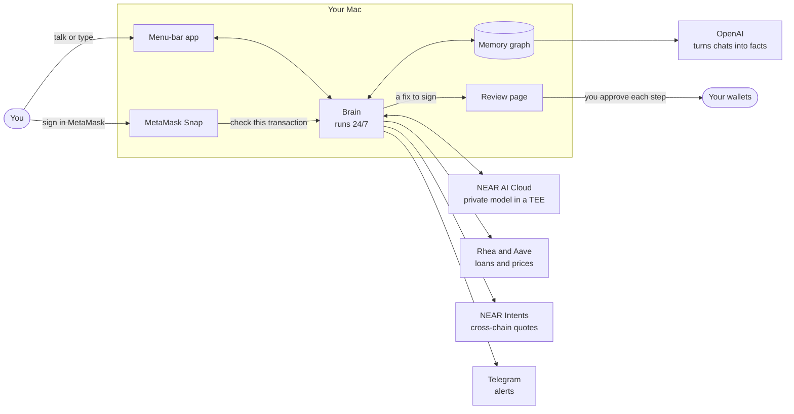

# Nierwall

**A private DeFi assistant that lives in your Mac's menu bar.** Nierwall watches your crypto loans around the
clock, warns you before they get liquidated, prepares a fix you sign in your own wallet, and checks transactions
inside MetaMask before you approve them. You can talk to it like Siri.

Built for the NEAR HACKATHON. Tracks: Privacy & Private AI · AI Security & Defense · Open Innovation.

**In one line:** prices drop → Nierwall notices → alert on your Mac and phone → you pick a fix → you sign it in
your wallet → Nierwall confirms it worked.

---

## Why

Many people borrow against their crypto: deposit NEAR or ETH, borrow stablecoins against it. If prices fall far
enough, the lending protocol liquidates the loan. It sells part of your collateral at a discount, and you take
the loss. This often happens overnight, faster than anyone checks a dashboard.

The other common way to lose money is the moment of signing: an unlimited token approval, a withdrawal that
leaves a loan exposed, a deposit to the wrong address.

Most tools today either send a bare price alert or ask you to hand a bot your keys. Nierwall does neither. It
knows your positions and the limits you set, explains what's happening in plain words, prepares the fix, and
leaves the signing to you.

## What it does

### 1. You talk to it

Hold **⌘⌥** in any app and a Siri-style orb appears at the top of your screen, over whatever you're doing, with a
soft glow around the edges. Speak, let go, and Nierwall answers out loud. For example:

- "How's my Rhea loan?"
- "What happens if NEAR drops 20%?"
- "Ping me if my Rhea health goes under 1.5."

The orb follows your voice, swirls while Nierwall thinks, and pulses while it talks. When an answer has something
to act on, such as a fix with a **Review & sign** button or a new watch to confirm, the Nierwall panel opens under
the menu bar with the details. Nierwall starts a new watch only after you confirm it. The full chat history, with
health gauges and alerts, is always one click away on the shield in the menu bar.

Speech recognition runs on the Mac, and the audio never leaves it. Holding ⌘⌥ is detected without keyboard
permissions, so Nierwall never sees what you type, and pressing another key with ⌘⌥ (a shortcut like ⌘⌥Esc)
doesn't trigger it.

### 2. It keeps watch and brings you a fix

A background service (the "brain") checks your loans on **Rhea** (NEAR) and **Aave V3** (Base) every minute, and
every 20 seconds when you're close to a limit. It can watch:

- loan health, and how far prices can fall before liquidation
- price levels and moves ("tell me if ETH drops 10%")
- a minimum balance you want to keep in a wallet
- its own data sources, so it tells you when it can't see instead of going quiet

When a limit is crossed you get a Mac notification and a Telegram message with fix options. If you don't react
it reminds you, if things get worse it escalates, and when the loan recovers it tells you and closes the issue.

Here is an alert from `pnpm demo` (shortened), on a public account during a simulated 9% NEAR drop:

> **Rhea · NEAR is below your floor.** Health factor 1.25 (your floor 1.28).
> **A.** Move 1,359 USDC from Demo cash wallet (Base) to NEAR, then repay on Rhea → health 1.48.
> NEAR Intents: about 1,358.84 USDC arrives in ~35 s.
> **B.** Add 916 NEAR as collateral → health 1.48.

Fix A moves money between chains with **NEAR Intents**. Before you see it, Nierwall gets a live quote and checks
it: the money goes to your own account, the route and amount match, the minimum you receive is within slippage,
and there's enough time to send. A review page then hands each step to your own wallet: MetaMask for Base, your
NEAR wallet for NEAR. Nierwall follows the transfer and the repayment until both are confirmed.

### 3. It checks transactions before you sign

The **Nierwall Snap** adds a panel to MetaMask's confirmation screen for transactions on Base:

- **Aave actions:** your health factor before and after. "Withdraw all cbBTC" on a real position shows
  1.62 → 0.14 and is marked critical.
- **Approvals:** warns about unlimited approvals and unknown spenders.
- **Transfers:** checks that a deposit matches the Nierwall quote you're paying, and warns when you send to an
  address that isn't yours or go below a balance you said to keep.

It never blocks a transaction. If it can't decode one, it says "not checked", never "looks fine".

## How it works



| Part | What it does | Built with |
|------|--------------|------------|
| Menu-bar app | Siri-style voice overlay, chat panel, cards, notifications | Swift, SwiftUI, Apple SpeechAnalyzer |
| Brain | Reads loans and prices, runs watches, plans fixes, talks to the AI, sends Telegram alerts, answers the Snap | TypeScript on Node 24 |
| Memory | Remembers your goals, limits and preferences as dated facts, so it knows what changed and when | Graphiti (Zep's open-source engine) on an embedded FalkorDB, Python |
| MetaMask Snap | Pre-sign checks inside MetaMask | MetaMask Snaps SDK |
| Review page | Hands each step of a fix to your wallet | MetaMask (EIP-6963), NEAR Connect |

## Built on NEAR

| | How Nierwall uses it |
|---|---|
| **NEAR AI Cloud** | Runs the assistant's model (`z-ai/glm-5.3-flash`) inside a TEE. Nierwall verifies the attestation before sending anything, encrypts chats end to end, and verifies each reply's signature. The app shows "NEAR AI · TEE verified". |
| **Rhea** | NEAR's lending protocol. Nierwall reads your Rhea loans and previews every fix with Rhea's own risk weights. |
| **NEAR Intents** | Moves USDC from Base to NEAR to repay a Rhea loan, through the 1Click API, with Nierwall's own checks on every quote. |
| **NEAR Connect** | Opens your NEAR wallet to sign the NEAR side of a fix. |

## Privacy and safety

- **No keys, ever.** Nierwall never asks for or stores a seed phrase or private key, and it never signs. If you
  paste something that looks like one, it isn't sent anywhere, and Nierwall tells you to move those funds.
- **Private AI.** The model runs in secure hardware on NEAR AI Cloud, and Nierwall checks that before the first
  prompt.
- **Numbers are double-checked.** Every number in an AI answer must match the data Nierwall computed. If one
  doesn't, you get the plain computed answer instead.
- **Memory can't grant powers.** It stores only your own messages and Nierwall's own events, never text from
  websites or token names. It can shape answers and suggestions, but a new watch always needs your confirmation.
- **Simulations are labeled.** Simulated price drops say SIMULATED everywhere and are never stored in memory.

**What stays on your Mac:** your wallet list and nicknames, the memory graph, history, and voice audio.

**What leaves it:**

| Where | What |
|-------|------|
| NEAR AI Cloud (TEE) | Your messages and the position data looked up to answer them, with wallet nicknames instead of addresses |
| OpenAI | Text used to build memory, with nicknames, never addresses |
| Telegram | Alert text, at the detail level you choose (`TELEGRAM_DETAIL`) |
| NEAR and Base RPCs | Reads of your positions and balances |
| NEAR Intents | A quote for a cross-chain fix you open. The transfer itself links your Base and NEAR addresses on-chain. |

## Try it

### Quick look: two minutes, no keys

```bash
git clone https://github.com/ConduenceAi/Nierwall.git
cd Nierwall
pnpm install
pnpm demo
```

You need Node 24+ and pnpm 10. The demo reads three public accounts (read-only; they aren't ours) and shows a
real Rhea loan and a real Aave loan with their live health. Then it sets three watches and simulates a NEAR -9% /
ETH -10% drop. You see the alerts, the fixes with a live NEAR Intents quote, and the recovery. Everything except
the price drop is live mainnet data.

### Full setup on your Mac

You need macOS 14+ (voice needs macOS 26), Node 24+, pnpm 10, Python 3.14 from Homebrew, and the Xcode Command
Line Tools.

```bash
cp .env.example .env                                 # add your keys (see below)
cp config/wallets.example.json config/wallets.json   # your addresses and nicknames
pnpm sign:build                                      # build the review-and-sign page
pnpm memory:setup                                    # Python environment for the memory service

pnpm brain                                           # terminal 1: the always-on brain
pnpm memory                                          # terminal 2: the memory service
pnpm mac                                             # build and open the menu-bar app
```

Every key is optional. Nierwall runs without them, with less:

| Key in `.env` | Turns on | Without it |
|---------------|----------|------------|
| `NEAR_AI_API_KEY` | Conversation on NEAR AI Cloud | Short built-in answers from computed numbers |
| `OPENAI_API_KEY` | Memory | Nothing is remembered |
| `TELEGRAM_BOT_TOKEN` | Alerts on your phone (create a bot with @BotFather) | Alerts on the Mac only |

Without `config/wallets.json`, Nierwall watches the same public demo accounts as `pnpm demo`. There's nothing to
sign with those.

| Try | How | You should see |
|-----|-----|----------------|
| Ask a question | Hold ⌘⌥ in any app, speak, let go | The orb answers out loud; anything to click opens in the panel |
| Set a watch (needs `NEAR_AI_API_KEY`) | Hold ⌘⌥ and say "Ping me if my Rhea health goes under 1.3", then press Confirm | The watch turns active |
| Simulate a crash | `pnpm simulate NEAR -9` (undo with `pnpm simulate off`) | An alert labeled SIMULATED on the Mac and in Telegram, with fixes |
| Get alerts on your phone | Click "Get alerts on Telegram" in the panel, then tap Start in Telegram | "Linked" in Telegram |
| Check a transaction | `pnpm snap`, then open `http://127.0.0.1:7420/snap/install` in a browser with MetaMask Flask | Nierwall's panel in MetaMask's confirmation screen |
| Keep it running | `pnpm always-on` (undo with `sh ops/uninstall-always-on.sh`) | Brain, memory and app start at login and restart if they crash |

Tests: `pnpm test` runs 21 tests, 4 of them against mainnet. `OFFLINE=1 pnpm test` skips the mainnet ones.

## Status

Working on live mainnet data:

- loan and price readers (Rhea matches Rhea's own SDK exactly, Aave within 2%)
- watches and alerts
- fix planning with live NEAR Intents quotes
- the Snap's transaction analysis
- the menu-bar app builds and connects to the brain

Built but not yet tested end to end:

- AI conversation on NEAR AI Cloud, memory, and Telegram. They need API keys.
- voice and notifications in the menu-bar app
- the Snap inside MetaMask Flask
- real on-chain signing. Try it with a tiny amount first.

The full tracker is in [docs/PROGRESS.md](docs/PROGRESS.md). The original design plan is
`docs/guardian-plan.html`; open it in a browser.

### Known limits

- Checks pause while your Mac sleeps or is offline, because the brain runs on your Mac.
- Aave positions on Base are watched and checked by the Snap, but fixes are Rhea-only for now.
- "Add NEAR collateral" opens the Rhea app instead of building the transaction.
- The Snap can't decode NEAR transactions sent through MetaMask yet. It says "not checked" for them.
- Installing a local Snap, and MetaMask's full-screen critical warning, need MetaMask Flask.

## Project layout

| Path | What's inside |
|------|---------------|
| `apps/brain` | The always-on brain: readers, watches, planner, local API, Telegram, NEAR AI agent, Snap analysis |
| `apps/mac` | The menu-bar app (Swift package) |
| `apps/snap` | The MetaMask Snap |
| `apps/sign` | The local review-and-sign page |
| `services/memory` | The memory service (Graphiti behind a small FastAPI app) |
| `ops` | launchd setup for running 24/7 |
| `docs` | Design plan and progress tracker |

Internal package and file names still use the project's working name, `guardian`.

## Libraries and AI disclosure

Built during the hackathon, starting 12 Nov 2026. Most of the code was written by Claude Code under the team's
direction. There is no code from before the hackathon. Main libraries: `@rhea-finance/cross-chain-sdk`,
`@nearai/inference-sdk`, `@hot-labs/near-connect`, `viem`, `hono`, `zod`, `@metamask/snaps-sdk`, `graphiti-core`,
`falkordblite`, `fastapi`.

## License

MIT. See [LICENSE](LICENSE).
